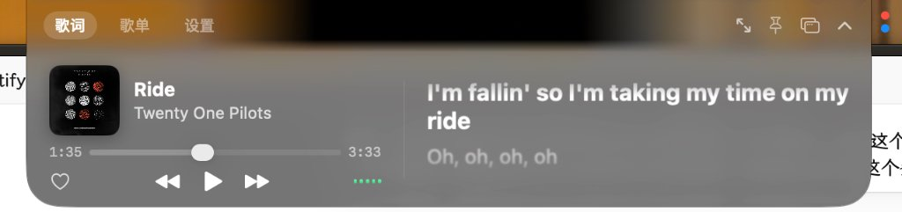
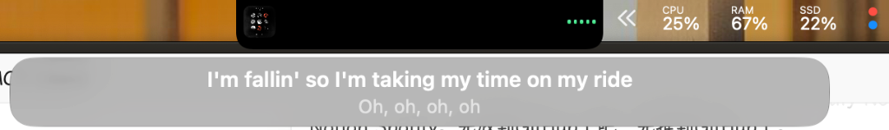
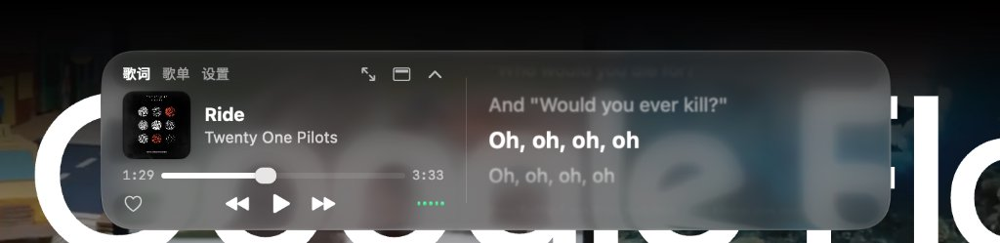
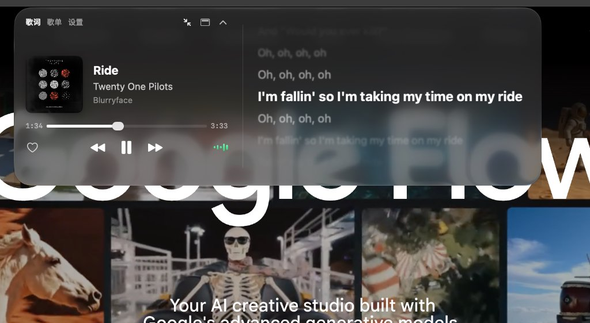

# SpotifyNotch

A music-focused native SwiftUI Dynamic Island for MacBook notch screens, built for local Spotify playback with Apple Liquid Glass, synchronized LRCLIB lyrics, playlist management, and system recording indicators.

### Preview

| Notch Expanded (Liquid Glass) | Collapsed Notch + Optional Lyrics Pill |
| --- | --- |
|  |  |

| Detached Floating Glass (Compact) | Detached Floating Glass (Enlarged) |
| --- | --- |
|  |  |

## Features

- **Physical MacBook Notch Integration**: Sits flush with the top bezel (`mainMenuWindow + 3`) in pure black when collapsed, placing album artwork on the left wing and a 5-bar live equalizer on the right wing.
- **Anti-Accidental Hover & Pin Controls**: Hovering primes the notch with a subtle micro-expansion and opens after a configurable dwell delay (default `1.2s`). Single-click the top bar to pin it open; double-click to unpin; click the enlarge icon in the top-right to expand for 6–7 lines of lyrics, or detach it into a freely draggable floating Liquid Glass card.
- **Native macOS Liquid Glass & Fluid Lyrics**: Uses macOS 26+ `.glassEffect` with synchronized lyrics from [LRCLIB](https://lrclib.net) cached locally, featuring Apple Music-style focus zoom, soft blur for inactive lines, click-to-seek, and top/bottom gradient fade masks.
- **Zero-Polling Local Sync + Spotify Web API**: Listens to `com.spotify.client.PlaybackStateChanged` and AppleScript for zero-latency local playback state; integrates Spotify OAuth (`http://127.0.0.1:8888/callback`) for liking tracks, browsing playlists sorted by recently played with cover art, playing playlists, and adding the current track to any playlist.
- **Live Privacy Indicators**: Detects active microphone (`CoreAudio`), camera (`CoreMediaIO`), and screen recording sessions and surfaces compact status dots directly inside the notch.

## Build & Run

Built with Swift Package Manager — no full Xcode installation required (Apple Command Line Tools with Swift 6+ is sufficient):

```bash
./scripts/build-app.sh
open build/SpotifyNotch.app
```

On first launch, allow macOS Automation permission so `SpotifyNotch` can read and control `Spotify.app`.

## Spotify Web API Setup (Like & Playlists)

1. Create an app in the [Spotify Developer Dashboard](https://developer.spotify.com/dashboard) and add `http://127.0.0.1:8888/callback` as a Redirect URI.
2. Expand the notch, open the **设置 (Settings)** or **歌单 (Playlists)** tab, enter your `Client ID` and `Client Secret`, and complete one-time browser authorization.
3. Optional: set `SPOTIFY_MCP_CONFIG_PATH` if you want `SpotifyNotch` to share its OAuth token file with a local `spotify-mcp-server` setup.

## License

MIT
